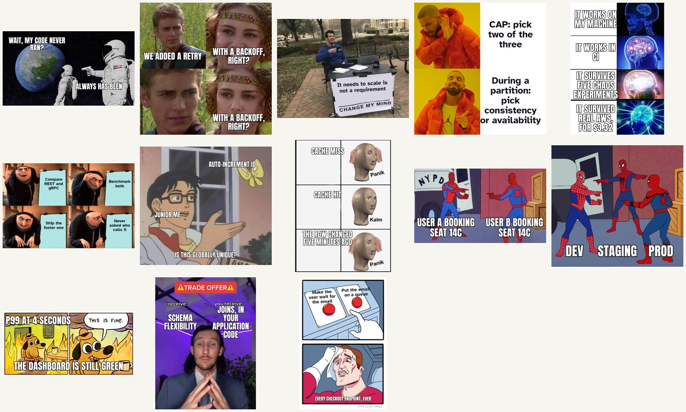

# meme-kit

Classic meme templates with your text on them, rendered from a JSON spec.

Write a `meme.json` naming a template and the text for each panel. You get a
JPEG back, with the type fitted to every box and kept the same size across
panels, the way a hand-made meme looks. Built for the image near the top of a
technical blog post, but the output is a plain JPEG, so it works anywhere.



## Why

Meme generator websites give you a watermark, a guess at the font size, and an
image you can't rebuild when you change one word. Here the meme is a small text
file that lives next to the post. Change a word and rebuild; the output is the
same every time.

## Requirements

- Node 22.12+ and npm (for [puppeteer](https://pptr.dev), which brings its own Chromium)
- `bash` (macOS/Linux, or Git Bash on Windows)

```sh
git clone https://github.com/rishabh0111/meme-kit.git
cd meme-kit
npm install
npm run fetch                            # downloads the template images into templates/
./build-memes.sh --examples drake        # renders examples/drake/drake.jpg
```

The template images are not in this repo (see
[Templates and copyright](#templates-and-copyright)). `npm run fetch` downloads
each one from the source URL in `templates.json` and checks it against the
recorded sha256.

## Quick start

1. Make a folder for the meme and write a spec in it:
   ```sh
   mkdir -p memes/2026-10-01-caching
   ```
   ```json
   { "template": "panik-kalm-panik",
     "panels": [ "Cache miss",
                 "Cache hit",
                 "The row changed five minutes ago" ] }
   ```
   Save it as `memes/2026-10-01-caching/meme.json`.
2. Build it:
   ```sh
   ./build-memes.sh memes/2026-10-01-caching
   ```
   The JPEG lands beside the spec, named after the folder without its date
   prefix: `memes/2026-10-01-caching/caching.jpg`. Set `"out": "name.jpg"` in
   the spec to choose the name yourself.

`memes/` is just the default location (override with `MEMES_DIR` or pass any
path). Keep the specs wherever your posts live; a folder per post holding its
draft, its `meme.json` and the rendered image works well.

## Building

```
./build-memes.sh path/to/meme.json        one spec
./build-memes.sh posts/                   every meme.json under a folder
./build-memes.sh posts/ caching           ...only paths containing "caching"
./build-memes.sh --examples [template…]   the specs in examples/
QUALITY=90 ./build-memes.sh …             JPEG quality (default 86)
node render-meme.js meme.json out.png     one spec to any path, PNG or JPEG
```

Output is rendered at 1.5× the template's size and saved as JPEG at quality 86:
roughly 90–350 KB, which a blog post can carry.

## Writing a meme

A spec is a template name and its panel texts, in box order:

| Key | Meaning |
|---|---|
| `template` | a key from the table below |
| `panels` | one string per text box, in order; `""` leaves a box empty |
| `uniform` | `false` lets each box keep its own largest size instead of sharing one |
| `dpr` | output scale, default `1.5` |
| `out` | output filename for `build-memes.sh`, default `<folder name>.jpg` |

Keep panels short. The type shrinks until the text fits, so a long panel works,
but it makes every panel small, because they all share one size.

## Templates

| Template | Panels, in order | Text style |
|---|---|---|
| `always-has-been` | the realisation (left astronaut); "always has been" (right) | impact |
| `anakin-padme` | Anakin's line; Padmé's hopeful reply; Padmé's reply again, now worried | impact |
| `change-my-mind` | the opinion on the table sign | dark |
| `drake` | what he rejects; what he approves | dark |
| `expanding-brain` | four ideas, from smallest brain to most glowing | impact |
| `grus-plan` | steps one to four on the board; the last one is the problem | dark |
| `is-this-a-pigeon` | the person; the butterfly; the question | impact |
| `panik-kalm-panik` | the panic; the calm; the panic again | impact |
| `spiderman-pointing` | left Spider-Man; right Spider-Man | impact |
| `spiderman-triple` | left, middle and right Spider-Man | impact |
| `this-is-fine` | the situation (top left); a caption along the bottom | impact |
| `trade-offer` | "i receive"; "you receive" | impact |
| `two-buttons` | left button; right button; the sweating person | dark |

`examples/<template>/meme.json` is a working spec for each one.

Two text styles, set per template in `templates.json` (or per box):

- `impact`: Anton, an Impact-alike, uppercase, white with a hard black
  outline. For text sitting on a photo.
- `dark`: Atkinson Hyperlegible Bold in near-black, no outline. For templates
  with blank space to write in, like Drake or Two Buttons.

## Adding a template

1. Put the image in `templates/`.
2. Add an entry to `templates.json`: `file`, the image's pixel size `w` and
   `h`, a default `style`, and `boxes`. Each box is `x`, `y`, `w`, `h` as
   fractions of the image (0–1), with optional `style` and `rot` (degrees).
   Add `source` (a URL) and `sha256` if you want `npm run fetch` to download it
   for other people.
3. Write a spec in `examples/<template>/meme.json`, build it with
   `./build-memes.sh --examples <template>`, and adjust the boxes until the
   text sits where it should.

## Templates and copyright

Meme templates are other people's pictures: Drake's is a still from a music
video, This Is Fine is a panel from KC Green's comic. That's why this repo
holds only their source URLs and checksums, and `npm run fetch` downloads them
from imgflip's public template list onto your machine. Using a meme in your own
blog post is ordinary and low-risk; whether a particular use is fine is still
your call. One template is deliberately missing: Distracted Boyfriend is a
stock photo whose rights holder has pursued people who used it.

`docs/examples.jpg` shows the examples rendered, so the README has something
to show.

## License

Code: [MIT](LICENSE). Fonts in [`fonts/`](fonts) are under the SIL Open Font
License 1.1 ([`fonts/OFL.txt`](fonts/OFL.txt)): Anton and Atkinson Hyperlegible.
The template images are not covered by this license and are not in this repo.

Covers for the same posts: [cover-kit](https://github.com/rishabh0111/cover-kit)
renders an animated GIF from a JSON spec in the same way.
